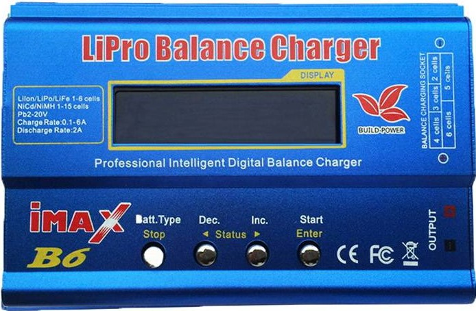
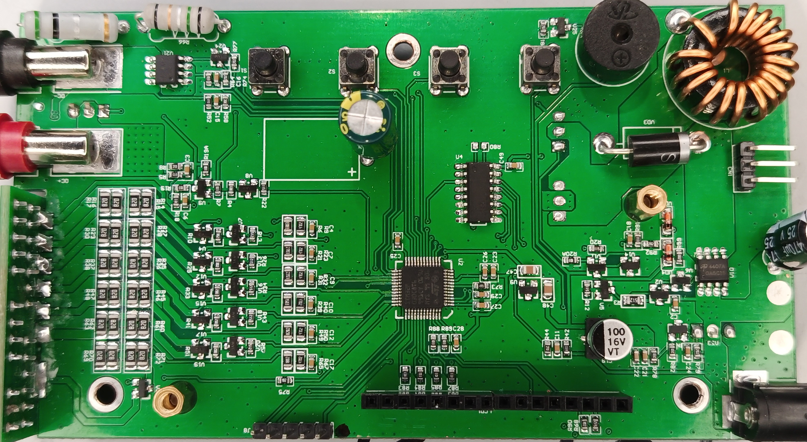
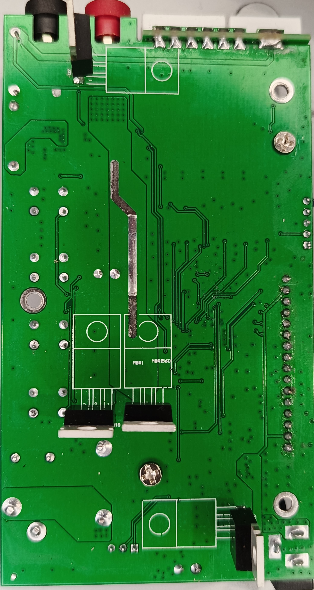
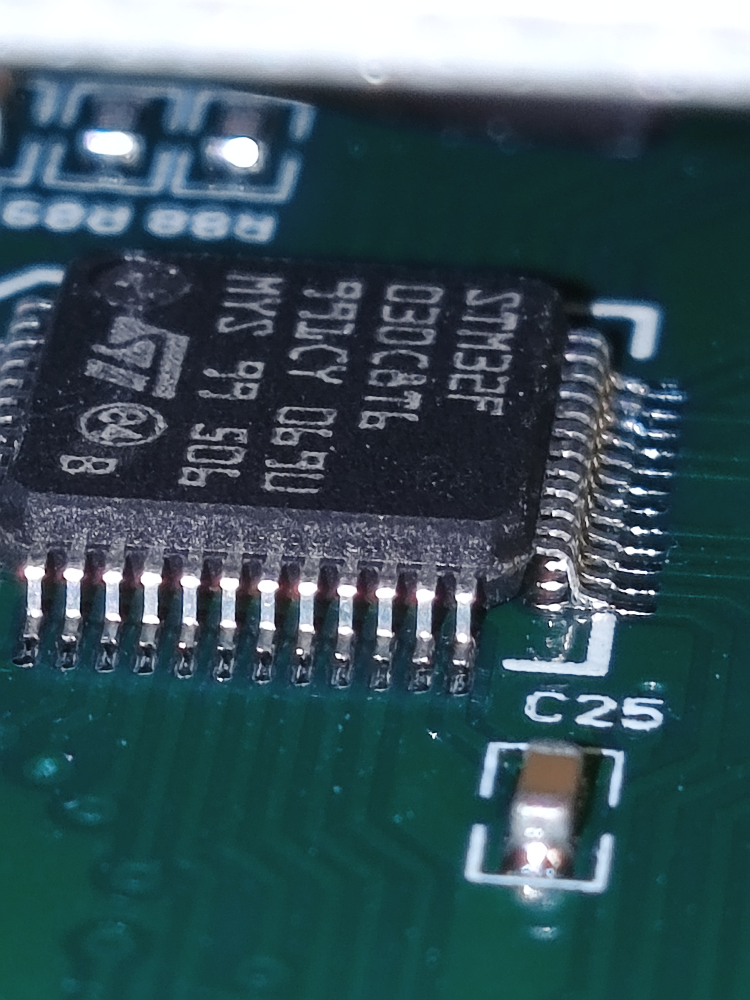
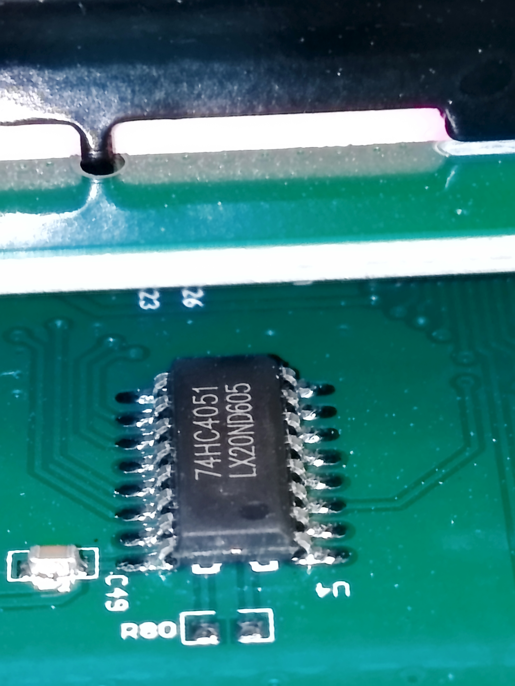
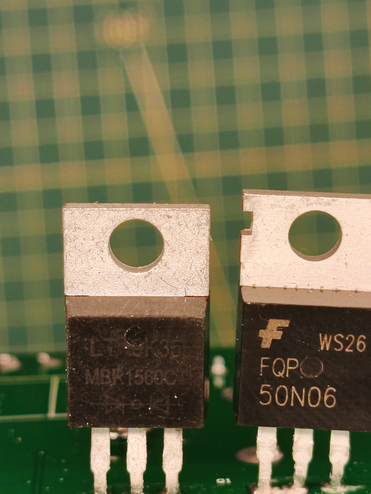
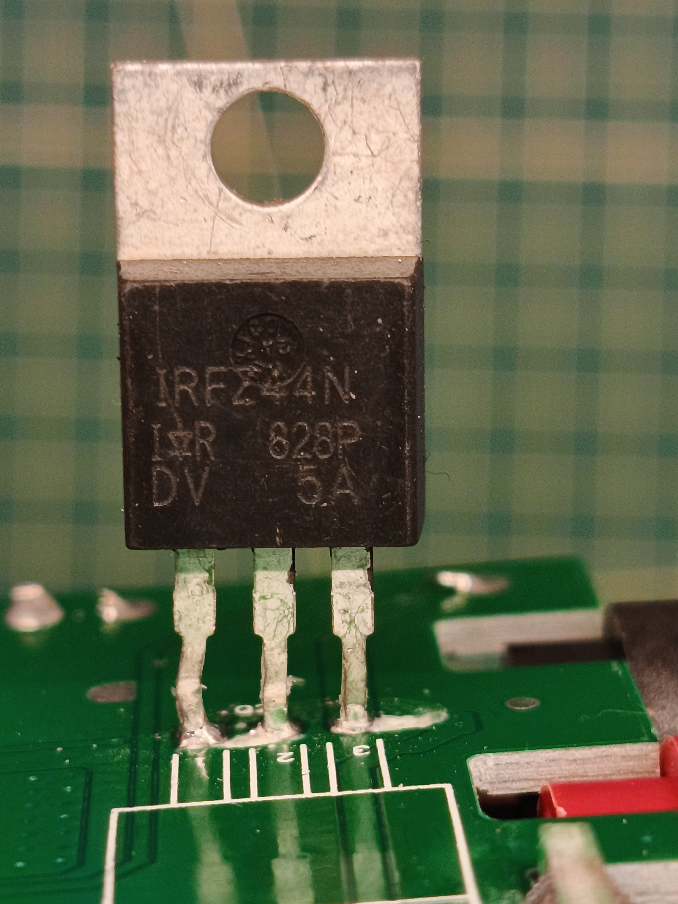
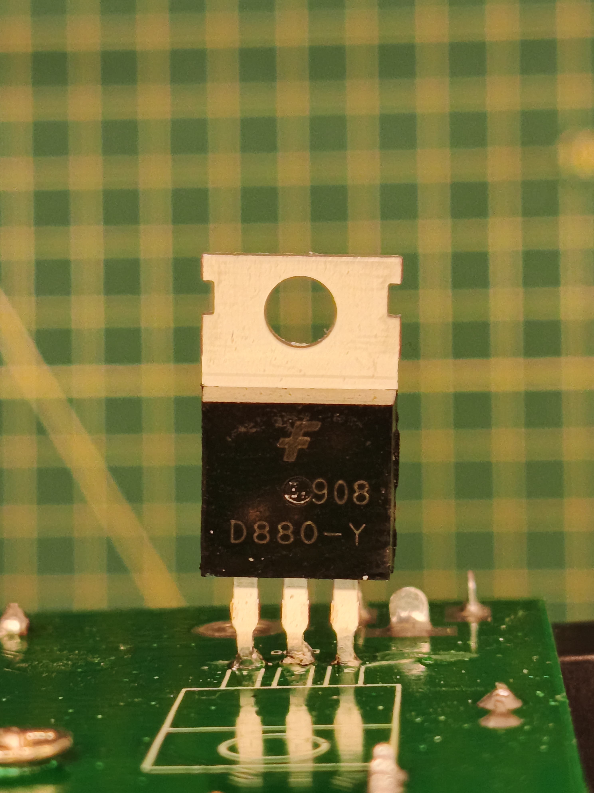

# IMAX B6 PRO — Альтернативная прошивка и телеметрия (STM32F030C8T6)

Открытая модульная прошивка с нуля для модифицированных клонов балансирного зарядного устройства **IMAX B6** (ревизия на базе **STM32F030C8T6** без внешнего усилителя шунта LM358, с аналоговым мультиплексором `74HC4051`).

В комплект входит автономный веб-плоттер **`serial-plotter.html`** для мониторинга графиков напряжения, тока, ёмкости и внутреннего сопротивления в реальном времени через браузер (Web Serial API).

---

## 🚀 Возможности прошивки

* **Поддержка химии и сборок:** Работа с аккумуляторами **Li-Ion** (`4.20 В / 3.80 В / 3.10 В`) и **LiFePO4** (`3.65 В / 3.30 В / 2.60 В`) в конфигурациях от **1S до 6S**.
* **4 основных режима работы с АКБ:**
  * `CHARGE` — заряд по алгоритму **CC/CV** с автоматической связкой понижающего (**Buck**) и повышающего (**Boost**) преобразователей для сборок `4S–6S`.
  * `STORAGE` — перевод сборки в режим хранения с автоматическим выбором направления (дозаряд или разряд).
  * `DISCHARGE` — контролируемый разряд линейным каскадом на транзисторе `IRFZ44N`.
  * `BALANCE` — выравнивание банок через резистивные балласты (`820 Ом`).
* **Авто-режим без балансирного разъёма (`useVoutAs1S`):** Если балансир не подключён, прошивка автоматически определяет напряжение на силовых клеммах и позволяет безопасно заряжать/разряжать сборки со встроенной BMS (например, от шуруповёртов).
* **Лабораторный блок питания (`LAB POWER SUP.`):** Регулируемое выходное напряжение **`1.0 – 24.0 В`** (автоматический переход `Buck -> Buck+Boost` выше `10.5 В`) и ограничение тока **`0.1 – 5.0 А`** с защитой от перенапряжения (OVP).
* **Измеритель внутреннего сопротивления (`INTERNAL RES.`):** Двухпроходный импульсный замер сопротивления каждой ячейки или всей сборки в **мОм** с оверсэмплингом АЦП `x128`.
* **Аппаратные защиты:**
  * Ограничение входной мощности заряда (`MAX_OUTPUT_WATTS = 19.5 Вт`) — защищает штатный блок питания `12 В / 2 А` от просадки и перезагрузки.
  * Тепловое ограничение мощности разряда (`MAX_DISCH_WATTS = 5.5 Вт`) — защищает транзисторы `IRFZ44N` и `D880-Y` от перегрева при работе без активного охлаждения.
  * Автоматическая калибровка нуля токового шунта перед каждым запуском.

---

## 🔧 Аппаратная совместимость и документация

Прошивка разработана под ревизию платы с **прямым съёмом сигнала с токового шунта на АЦП микроконтроллера** (без ОУ LM358):

| Компонент | Маркировка / Модель | Назначение |
| :--- | :--- | :--- |
| **Микроконтроллер** | `STM32F030C8T6` (LQFP48) | Основной контроллер (`48 МГц`, Flash `64 КБ`, RAM `8 КБ`) |
| **Мультиплексор** | `74HC4051` (SOIC-16) | Коммутация датчиков `V_IN`, `TEMP` и тока разряда |
| **Выходной ключ АКБ** | `AO4468` (SO-8, `V21`) | Защита от переполюсовки и физическое отключение клемм |
| **Повышающий ключ** | `FQP50N06` (TO-220) | Ключ Boost-преобразователя для сборок `4S–6S` и режима БП |
| **Разрядный ключ** | `IRFZ44N` (TO-220) | Линейная нагрузка в режимах разряда и замера `IR` |
| **Стабилизатор +5 В** | `D880-Y` (TO-220) | Линейный регулятор питания подсветки LCD и LDO `3.3 В` |

Подробная схема трассировки и калибровочные формулы находятся в документации:
* [Паспорт проекта — Часть 1: Аппаратная платформа и трассировка](docs/IMAX_B6_PRO_Passport_Part1.md)
* [Паспорт проекта — Часть 2: Софт, интерфейс и калибровки](docs/IMAX_B6_PRO_Passport_Part2.md.md)

<b>📸 Фотографии платы и ключевых узлов (нажмите, чтобы развернуть)</b>

 

| Вид платы сверху | Вид платы снизу |
| :---: | :---: |
|  |  |

| Микроконтроллер STM32F030C8T6 | Мультиплексор 74HC4051 |
| :---: | :---: |
|  |  |

| Силовые ключи MBR1560C / 50N06 | Разрядный транзистор IRFZ44N | Стабилизатор D880-Y |
| :---: | :---: | :---: |
|  |  |  |

## 📂 Структура репозитория

* **`serial-plotter.html`** — автономный веб-плоттер телеметрии (работает локально в браузере).
* **`docs/`** — технические паспорта проекта и фотографии платы.
* **`IMAX_B6_PRO/`** — исходный код прошивки для Arduino IDE (14 файлов: `IMAX_B6_PRO.ino`, `config.h`, `hal_drivers`, `sensors`, `charger_fsm`, `lab_psu`, `ir_tester`, `ui_telemetry.h`, `ui_buttons.cpp`, `ui_lcd.cpp`, `telemetry.cpp`).
* **`IMAX_B6_PRO/build/STMicroelectronics.stm32.GenF0/`** — готовые скомпилированные бинарники (`.bin`, `.hex`, `.elf`).

---

## 🎮 Управление и интерфейс (LCD 1602)

Навигация осуществляется четырьмя штатными кнопками (`STOP`, `DEC`, `INC`, `START`):

1. **`>WORK TO CELLS <`** — работа с аккумуляторами:
   * `INC` / `DEC` — изменение текущего мигающего параметра (Химия АКБ, Число банок `1S..6S`, Режим, Ток).
   * Короткий `STOP` — переключение между параметрами.
   * Длинный `STOP` (`≥ 800 мс`) — возврат в главное меню.
   * `START` — запуск процесса.
   * *Во время работы:* `INC` / `DEC` переключают страницы дисплея (Общий экран с таймером и мА·ч → Напряжения банок `B1..B3` → `B4..B6`).
2. **`>   SERVICES   <`** — сервисные инструменты:
   * **`LAB POWER SUP.`** — настройка напряжения и тока (во время работы `INC`/`DEC` регулируют выходное напряжение на лету).
   * **`INTERNAL RES.`** — выбор числа банок `1S..6S` и замер сопротивления по нажатию `START`.
3. **`>   SETTINGS   <`** — системные настройки:
   * **`BUZZER: ON/OFF`** — включение или отключение звукового сопровождения.

---

## 🛠 Сборка и прошивка (Arduino IDE / ST-Link)

### Вариант 1: Готовая прошивка
В папке `IMAX_B6_PRO/build/STMicroelectronics.stm32.GenF0/` находятся готовые файлы `IMAX_B6_PRO.ino.bin` и `IMAX_B6_PRO.ino.hex` для загрузки через **STM32CubeProgrammer** или **ST-Link Utility** с помощью программатора **ST-Link V2**.

### Вариант 2: Сборка из исходников
1. Установите ядро **STM32duino** (`STM32 MCU based boards`) в Arduino IDE.
2. Выберите настройки платы:
   * **Board:** `Generic STM32F0 series`
   * **Board part number:** `Generic F030C8Tx`
   * **Upload method:** `SWD`
3. Откройте `IMAX_B6_PRO/IMAX_B6_PRO.ino` и нажмите **Upload**.

> ⚠️ **Важно про окно SWD:** Пин `PA_14` совмещает функции `SWCLK` (программатор) и `UART TX` (телеметрия). При включении питания прошивка держит `PA_14` в режиме отладки ровно **3 секунды**, после чего переключает его на передачу данных. Чтобы прошить плату через ST-Link, нажмите *Upload* и сразу подайте питание на IMAX B6 (или нажмите Reset).

---

## 📈 Подключение телеметрии и Serial Plotter

1. Подключите **RX** любого USB-UART преобразователя (`CH340`, `PL2303`, `CP2102`) к пину **4 разъёма J8** (`PA_14` / `SWCLK`), а **GND** — к общему минусу платы (линию `SWCLK` от ST-Link при этом необходимо отключить).
2. Откройте файл **`serial-plotter.html`** двойным кликом в браузере (Chrome, Edge или Opera с поддержкой Web Serial API).
3. Нажмите кнопку подключения и выберите COM-порт (скорость **`9600 бод`**).

Плоттер автоматически распознаёт старт и завершение любого режима работы, строит графики напряжения, тока и ячеек в реальном времени, ведёт статистику (`Min / Avg / Max`), считает ёмкость и отображает результаты замера внутреннего сопротивления `IR`.

---

## 📌 Распиновка STM32F030C8T6

| Пин STM32 | Ножка LQFP48 | Назначение | Пин STM32 | Ножка LQFP48 | Назначение |
| :--- | :---: | :--- | :--- | :---: | :--- |
| `PA_0` | 10 | АЦП: Токовый шунт (прямой съём) | `PB_3` | 39 | LCD 1602 `D7` |
| `PA_1..PA_6` | 11..16 | АЦП: Делители балансира `B1..B6` | `PB_4` | 40 | Пьезобуззер (`softBeep`) |
| `PA_7` | 17 | АЦП: Силовой выход `V_OUT` | `PB_5..PB_7` | 41..43 | LCD 1602 `D6, D5, D4` |
| `PA_8` | 29 | ШИМ `TIM1_CH1`: Разряд `IRFZ44N` | `PB_8` | 45 | LCD 1602 `E` |
| `PA_9` | 30 | ШИМ `TIM1_CH2`: Повышающий `Boost` | `PB_9` | 46 | LCD 1602 `RS` |
| `PA_10` | 31 | ШИМ `TIM1_CH3`: Понижающий `Buck` | `PB_10` | 21 | Кнопка `DEC` (`-`) |
| `PA_11, PA_12` | 32, 33 | Ключи балансира `Cell 4`, `Cell 3` | `PB_11` | 22 | Кнопка `INC` (`+`) |
| `PA_13` | 34 | `SWDIO` (ST-Link) | `PB_12` | 25 | Кнопка `START` |
| `PA_14` | 37 | `SWCLK` / `UART TX` (`9600` бод) | `PB_13` | 26 | Выходной ключ `AO4468` (**инверсный**) |
| `PB_1` | 19 | АЦП: Выход `Z` мультиплексора `74HC4051` | `PB_14, PB_15` | 27, 28 | Ключи балансира `Cell 6`, `Cell 5` |
| `PB_2` | 20 | Кнопка `STOP` | `PC_13, PC_14` | 2, 3 | Адреса `A`, `B` мультиплексора `74HC4051` |
| | | | `PF_6, PF_7` | 3, 4 | Ключи балансира `Cell 2`, `Cell 1` |

---

> [!WARNING]
> **Статус проекта: в активной разработке (Work in Progress)**
>
> Прошивка находится на стадии тестирования и доработки. Возможны изменения в архитектуре кода, протоколе телеметрии и калибровочных коэффициентах.
>
> **⚠️ Меры предосторожности:**
> * Не оставляйте заряжаемые или разряжаемые литиевые аккумуляторы без присмотра.
> * Перед первым использованием на другом экземпляре платы обязательно проверьте точность измерения напряжения (мультиметром) и тока (в разрыв цепи), при необходимости скорректируйте коэффициенты в `config.h`.
> * Автор не несёт ответственности за возможный выход из строя оборудования или аккумуляторов при использовании данной прошивки.
